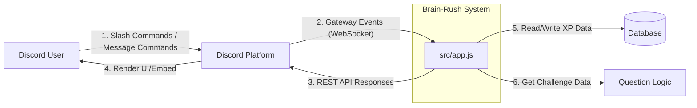

## 1. Discord Bot & Interaction (Michael)

### 1.1 Overview

This section describes the system context of Brain-Rush and how users communicate with the bot through Discord. It outlines the boundary between our application and external platforms, followed by a detailed explanation of the event-driven architecture that handles incoming interactions (such as slash commands and button clicks).

### 1.2 System Context Diagram

The following diagram illustrates how Brain-Rush interacts with the external environment as a black-box system.

System Boundary Explanation:

Discord Platform acts as the middleman. Users can interact via Slash Commands (handled by interactionCreate.js) or Prefix Message Commands like !level (handled by messageCreate.js). The bot relies on Discord's Gateway and REST API.

Brain-Rush System (src/app.js) is the core system boundary. It receives events, processes them, and sends responses.

Database & Question Logic are treated as external dependencies (detailed in Sections 2 and 3).

### 1.3 Event Handling Explanation
To translate user inputs (like /leaderboard) into bot actions, Brain-Rush uses an Event-Driven Architecture. The lifecycle of an event operates as follows:

1. Command Registration (REST API)
Before the bot can receive commands, we use a dedicated script (src/registerCommands.js) to send a REST request to the Discord Platform. This informs Discord of the available slash commands, allowing users to see and trigger them in the UI.

2. Event Reception (Gateway WebSocket)
Once logged in via src/app.js, the bot maintains a persistent WebSocket connection to the Discord Gateway. When a user executes a command, Discord pushes an INTERACTION_CREATE event through this socket.

3. Event Loading and Routing
During startup, helper scripts (src/helpers/loadEvents.js and loadFiles.js) automatically scan and load all event listeners from the src/events/ directory.
The src/events/interactionCreate.js file acts as the central router. It listens for the INTERACTION_CREATE event and routes the payload based on the interaction type (e.g., ChatInputCommand or Button) and the commandName (e.g., matching it to the leaderboard handler).

4. Asynchronous Response
The handler then executes the business logic. For example, it will request data from the XP module (Person 3). Once the data is retrieved, it constructs a Discord Embed and sends it back via the REST API. This WebSocket-in / REST-out mechanism ensures the bot remains highly responsive and can handle concurrent interactions across multiple servers.

### 1.4 Extension Guide
How to add a new slash command:

Define the command's data and execution logic in the codebase.

Run the registration script to sync the new command to Discord.

Add the routing logic in src/events/interactionCreate.js by matching the new commandName. The core app.js configuration does not need to be modified.

Note: For the data flow of the /leaderboard command and XP calculations, please refer to Section 3.
