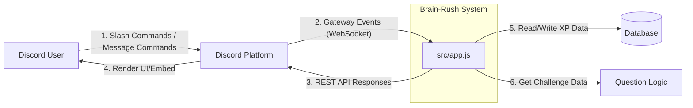
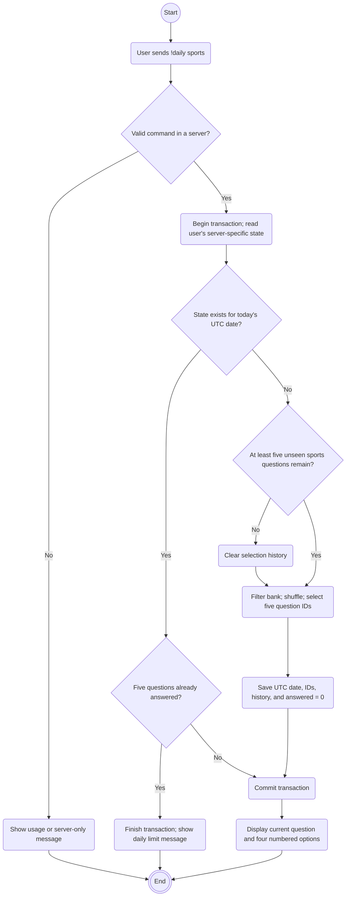
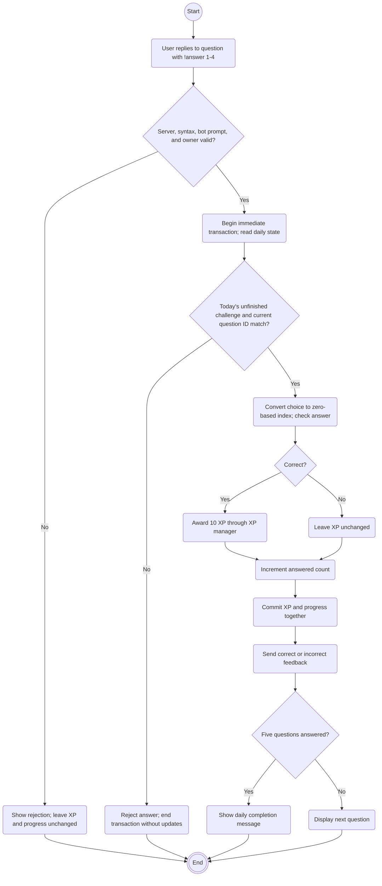

## 1. Discord Bot & Interaction (Michael)

### 1.1 Overview

This section describes the system context of Brain-Rush and how users communicate with the bot through Discord. It outlines the boundary between our application and external platforms, followed by a detailed explanation of the event-driven architecture that handles incoming interactions (such as slash commands and message commands).

### 1.2 System Context Diagram

The following diagram illustrates how Brain-Rush interacts with the external environment as a black-box system.

System Boundary Explanation:

Discord Platform acts as the middleman. Users can interact via Slash Commands (handled by `interactionCreate.js`) or Prefix Message Commands like !level (handled by `messageCreate.js`). The bot relies on Discord's Gateway and REST API.

Brain-Rush System (`src/app.js`) is the core system boundary. It receives events, processes them, and sends responses.

Database & Question Logic are treated as external dependencies (detailed in Sections 2 and 3).

### 1.3 Event Handling Explanation
To translate user inputs (like /leaderboard) into bot actions, Brain-Rush uses an Event-Driven Architecture. The lifecycle of an event operates as follows:

1. Command Registration (REST API)
Before the bot can receive commands, we use a dedicated script (`src/registerCommands.js`) to send a REST request to the Discord Platform. This informs Discord of the available slash commands, allowing users to see and trigger them in the UI.

2. Event Reception (Gateway WebSocket)
Once logged in via `src/app.js`, the bot maintains a persistent WebSocket connection to the Discord Gateway. When a user executes a command, Discord pushes an INTERACTION_CREATE event through this socket.

3. Event Loading and Routing
During startup, helper scripts (`src/helpers/loadEvents.js` and `loadFiles.js`) automatically scan and load all event listeners from the `src/events/` directory.
The `src/events/interactionCreate.js` file acts as the central router. It listens for the INTERACTION_CREATE event and routes the payload based on the interaction type (e.g., ChatInputCommand or Button) and the commandName (e.g., matching it to the leaderboard handler).

4. Asynchronous Response
The handler then executes the business logic. For example, it will request data from the XP module (Person 3). Once the data is retrieved, it constructs a Discord Embed and sends it back via the REST API. This WebSocket-in / REST-out mechanism ensures the bot remains highly responsive and can handle concurrent interactions across multiple servers.

1.4 Extension Guide
### 1.4 Extension Guide

**How to add a new slash command:**
1. Define the command's data and execution logic in the codebase.
2. Run the registration script to sync the new command to Discord.
3. Add the routing logic in `src/events/interactionCreate.js` by matching the new commandName. The core `app.js` configuration does not need to be modified.

**How to add a new message (prefix) command:**
If you want to add a command that is triggered by normal messages (e.g., !level):
1. Write the execution logic and add it to the `src/events/messageCreate.js` file.
2. Add a condition to check if the message content starts with your prefix and command name.
3. *Note: Unlike slash commands, message commands do NOT need to be registered with Discord via the REST API.*

> *Note: For the data flow of the /leaderboard command and XP calculations, please refer to Section 3.*

## 2. Question Generation and Daily Challenge Logic (Subodh)

**Contributor: Subodh (Person 2)**

**Scope:** Question selection, Discord presentation, answer validation, and daily challenge progress. Describes team `main` at commit `7b5544d`.

### Responsibilities and boundaries

The challenge subsystem connects Discord messages to a predefined question bank and saved daily progress. It uses ordinary JavaScript modules rather than classes. Discord-specific checks and formatting are separated from question selection and answer checking, allowing the selection logic to be tested without a live Discord connection. The daily service coordinates persistence and calls the XP subsystem when an answer is correct.

| Component | Responsibility |
| --- | --- |
| `src/events/messageCreate.js` | Ignores bot messages and delegates trivia commands to `handleTrivia`. Other commands continue through the existing handler. |
| `src/trivia/handleTrivia.js` | Handles `!daily sports` and `!answer 1` through `!answer 4`; checks server context, reply ownership, and bot authorship; formats questions and feedback as Discord messages. |
| `src/trivia/questionBank.js` | Holds 15 predefined sports questions with stable IDs, difficulty, four options, and a correct-option index. The exported bank and its entries are frozen. |
| `src/trivia/challenge.js` | Filters and shuffles eligible questions, returns display-safe copies, and checks answers against the bank. It has no Discord or database dependency. |
| `src/trivia/dailyChallenge.js` | Starts/resumes challenges, tracks daily attempts and question history, rejects inactive questions, and coordinates XP and progress updates. |
| `src/xp/xpStorage.js` and `src/xp/xpManager.js` | Provide the shared SQLite connection and XP award function used by the daily service. The XP/database section covers their wider responsibilities. |

### Question selection and saved state

`createChallenge` accepts interests, an optional difficulty, a count from one to five, and excluded question IDs. It normalizes interest names, filters the bank, shuffles a copy using Fisher–Yates, and selects distinct questions. It rejects invalid requests or insufficient eligible questions. Returned questions omit the answer key and copy the options array.

The current daily command always requests five sports questions with mixed difficulty. Although the selection function supports interest and difficulty filtering, the Discord daily interface does not yet offer saved interest preferences, difficulty selection, or AI-generated questions.

The `daily_challenges` table in `data/xp.sqlite` has one row per `(server_id, user_id)`. It stores the UTC date, five assigned question IDs, the number answered, and selection history. Question IDs and history are JSON text. The current question is the assigned ID at index `answered`; question text is read from the bank rather than duplicated in SQLite.

Starting again on the same UTC date resumes the saved challenge. On a later date, the service selects a new set. There is no scheduled midnight job: the date is checked when a command is handled. History records assigned questions, including ones the user did not answer. It resets when fewer than five unseen sports questions remain.

### Activity diagram: Start or resume a challenge

These activity diagrams use Mermaid flowchart syntax for GitHub rendering. Rounded boxes represent actions, diamonds represent decisions, and labeled arrows show alternatives. The second diagram continues the user interaction after a question is displayed.

### Activity diagram: Submit an answer

### Consistency, failure handling, and limitations

`answerDailyQuestion` checks the saved question ID before changing data. Both correct and incorrect valid answers consume one attempt; only correct answers award 10 XP. An answer to a question already passed in the current challenge is rejected. Server and user IDs come from the Discord message, while the prompt footer identifies its owner and question.

The daily service uses `better-sqlite3` immediate transactions and the same connection as the XP subsystem. XP and the answered count therefore commit together or roll back if the transaction fails. Discord replies happen after the commit and are outside the transaction. If a reply fails, the database still retains the accepted answer; `!daily sports` can resume at the saved position. Persistence requires preserving the SQLite file across deployment updates.

Prompt footers contain a user ID and question ID, but no date or challenge-instance ID. After the question bank cycles, an old prompt for an ID that is current again could be accepted. A future improvement is to bind prompts to a unique daily challenge instance. Also, question IDs referenced by saved challenges must remain resolvable when editing the bank.

### Verification and extension

`tests/dailyChallenge.spec.js` uses a temporary SQLite database to test resumption, correct-answer XP, repeated-answer rejection, incorrect-answer progress, the five-question limit, and isolation across users/servers. Private-server testing additionally checked persistence after a bot restart. Date rollover and Discord reply-validation paths need dedicated automated coverage.

To add topics, extend the bank with unique IDs and valid option indexes, then update the daily command's topic validation and the daily service's sports-specific history filtering together. To expose difficulty, pass the validated choice into selection and define how it is retained for the day's challenge. Keep Discord formatting in `handleTrivia.js` and selection/validation in `challenge.js` so these responsibilities remain independently testable.
